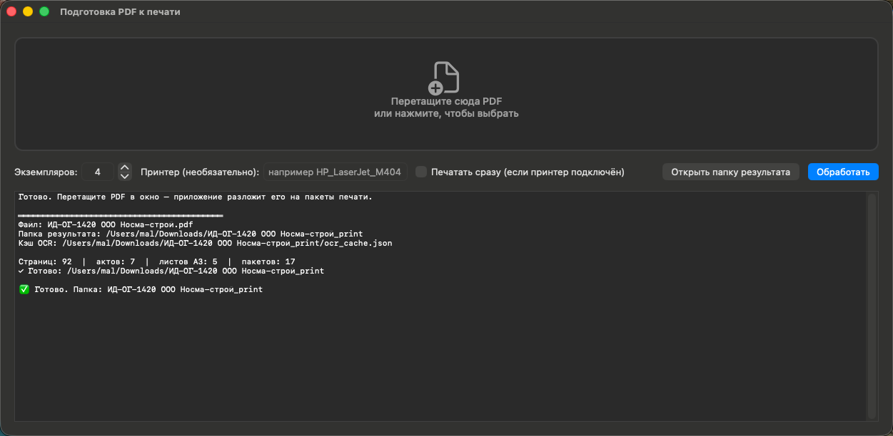

# PDF к печати — подготовка исполнительной документации

Приложение для macOS и CLI-скрипт: берут скачанный PDF исполнительной документации
(акты освидетельствования скрытых работ, сертификаты, схемы) и раскладывают его на
**пакеты с одинаковыми настройками печати**, чтобы напечатать несколько экземпляров
без ручного перебора страниц.

Задача, которую решает:

> Напечатать документ в 4 экземплярах. Все страницы односторонние, кроме
> «Акт освидетельствования скрытых работ» и следующей за ней — их печатать
> с оборотом по длинной стороне. Часть листов — А3.



## Что делает

1. Прогоняет OCR (tesseract, `rus`) по страницам — работает со сканами без текстового слоя.
2. Находит пары **«Акт освидетельствования скрытых работ»** (лицо + оборот) по шапке
   «Объект капитального строительства» / «составили настоящий акт».
3. Определяет формат каждого листа по геометрии страницы: **A4** или **A3**.
4. Режет PDF на пакеты, сохраняя исходный порядок страниц:

   | Режим | Что это | Настройка принтера |
   |---|---|---|
   | `duplex_A4` | пара листов акта | A4, двусторонняя, **длинная сторона** |
   | `simplex_A3` | листы А3 | A3, односторонняя |
   | `simplex_A4` | всё остальное | A4, односторонняя |

5. Пишет `print_plan.txt` (инструкция оператору), `print_commands.sh` (готовые
   команды `lp`) и `print_plan.json`.

Порядок страниц не меняется: пакеты нумеруются по порядку, оператор печатает
01 → 02 → … → N и раскладывает по экземплярам.

## Установка

Готовое приложение: [Releases](https://github.com/iMironRU/pdf-print-prepare/releases/latest) →
`PDFPrintPrepare-1.0.0.zip` → распаковать → перетащить в «Программы».
Нужны только зависимости ниже (`setup.sh` проверит их).

Сборка из исходников:

```bash
git clone https://github.com/iMironRU/pdf-print-prepare.git
cd pdf-print-prepare
bash setup.sh
```

Нужны: Python 3 + `pymupdf`, `tesseract` с языком `rus`.

```bash
brew install tesseract tesseract-lang
pip3 install pymupdf
```

## Вариант 1: приложение (перетащить PDF)

```bash
bash build_app.sh                       # соберёт build/PDFPrintPrepare.app
cp -R build/PDFPrintPrepare.app /Applications/
```

Дальше:

* перетащите PDF на иконку приложения в Dock/Finder, **или**
* откройте приложение и бросьте файл в окно (или кликните в зону — откроется диалог).

В окне задаются число экземпляров (по умолчанию 4), имя принтера (необязательно)
и галочка «печатать сразу». В логе видно прогресс OCR. По завершении —
кнопка «Открыть папку результата».

Приложение принимает и несколько файлов сразу — обработает по очереди.

## Вариант 2: командная строка

```bash
python3 pdf_print_analyzer.py "ИД-ОГ-1420 ООО Носма-строй.pdf" --copies 4
```

Ключи:

| Ключ | Смысл |
|---|---|
| `--copies N` | число экземпляров (по умолчанию 4) |
| `--printer ИМЯ` | подставить имя принтера в `print_commands.sh` |
| `--ocr-cache FILE` | готовый кэш OCR (повторный запуск за секунды) |
| `--dpi N` | DPI рендера для OCR (по умолчанию 100; 150 — точнее, медленнее) |
| `--lang rus` | язык tesseract |
| `--json` | вывести итог одной JSON-строкой (для скриптов) |

Результат — папка `<имя PDF>_print/` рядом с исходником:

```
ИД-ОГ-1420 ООО Носма-строй_print/
├── batch_01_simplex_A4_p1-11.pdf
├── batch_02_duplex_A4_p12-13.pdf
├── ...
├── print_plan.txt        ← инструкция оператору принтера
├── print_commands.sh     ← lp-команды (macOS/Linux)
├── print_plan.json
└── ocr_cache.json        ← повторный запуск не тратит время на OCR
```

## Печать

### macOS / Linux (CUPS)

```bash
cd "<...>_print"
bash print_commands.sh
```

Пакеты уходят в очередь по порядку, каждый с нужными `sides` и `media`.
Принтер выбирается из `-d` (по умолчанию — системный), либо задайте заранее:

```bash
python3 pdf_print_analyzer.py файл.pdf --copies 4 --printer "HP_LaserJet_M404"
```

### Windows / принтер на другом ПК

Без CUPS: перенесите папку `_print/` на принтерную машину и открывайте
`batch_NN_*.pdf` в Adobe Reader, выставляя настройки из `print_plan.txt`
(А4/А3, односторонняя/двусторонняя по длинной стороне).

## Пример: реальный документ

`ИД-ОГ-1420`, 92 страницы:

* 7 актов → пары `12–13`, `21–22`, `25–26`, `32–33`, `37–38`, `41–42`, `45–46`
* 5 листов А3 → `23–24`, `27–28`, `34`
* всё остальное — А4 односторонние
* итого 17 пакетов, 4 экземпляра

## Как это работает внутри

| Шаг | Реализация |
|---|---|
| Формат листа | PyMuPDF `page.rect`, порог длинной стороны 1000 pt (A4 ≈ 842, A3 ≈ 1191) |
| Начало акта | в тексте есть `объект капитальн…` **и** `застройщик` / `технический заказчик` / `лицо, осуществляющ…` |
| Оборот акта | `составили настоящий акт` **или** (`освидетельствован` **и** `предъявлен`) |
| Ремонт пар | если найден оборот, а лицо не распозналось — предыдущая страница повышается до начала акта |
| Нарезка | `fitz.insert_pdf` по одной странице, порядок исходного документа сохраняется |

## Ограничения

* OCR сканов с плохим качеством может не распознать шапку акта — тогда лист уйдёт
  в односторонние. Проверьте `print_plan.txt` перед печатью большого тиража.
* Форматы, отличные от A4/A3 (A2, A1, пользовательские), сейчас трактуются как A3 —
  если нужны, расширяется одной строкой в `page_format()`.
* Раскладка по экземплярам ручная: принтер печатает пакеты, оператор складывает стопки.
  Автоматическая сборка невозможна, когда A4 и A3 идут на разные лотки.

## Лицензия

MIT
